Mercado Express

Bom de perto. Melhor ainda na sua casa.

Projeto acadêmico desenvolvido para a atividade de Spring Security MVC. O Mercado Express é um mercado de bairro fictício, criado para aproximar clientes de produtos frescos e de pequenos produtores. A aplicação foi construída em Java com Spring Boot, Spring MVC, Thymeleaf e PostgreSQL.

Integrantes

Integrante
RM
Natália Cristina
RM564099
Nickolas Davi
RM564105
Rodrigo Silva
RM565162
Samara Vilela
RM566133
Otávio Ferreira
RM565960

Turma: 2TDSR  
Curso: Análise e Desenvolvimento de Sistemas  
IDE utilizada: IntelliJ IDEA

Um mercado com jeito de bairro

A página inicial foi pensada como a vitrine do projeto: uma identidade visual verde e creme, ilustrações de produtos frescos, uma seleção da semana e caminhos claros para cadastro e login. Depois de entrar, cada pessoa encontra a área correspondente ao seu perfil.

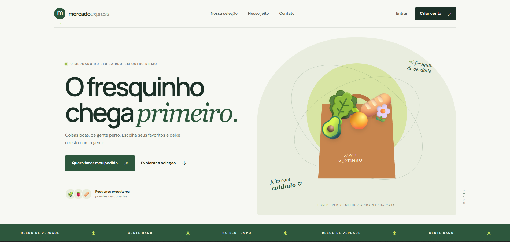

Cadastro e acesso

O visitante pode criar uma conta pela tela de cadastro. As contas criadas publicamente recebem o perfil CLIENTE; não é possível escolher ou solicitar o perfil de administrador pelo formulário.

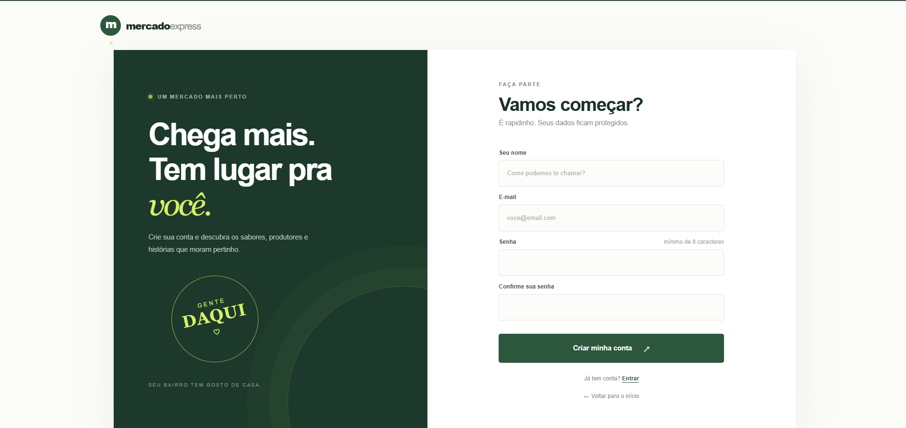

O login também tem uma tela própria, personalizada para o projeto, em vez da página padrão do Spring Security.

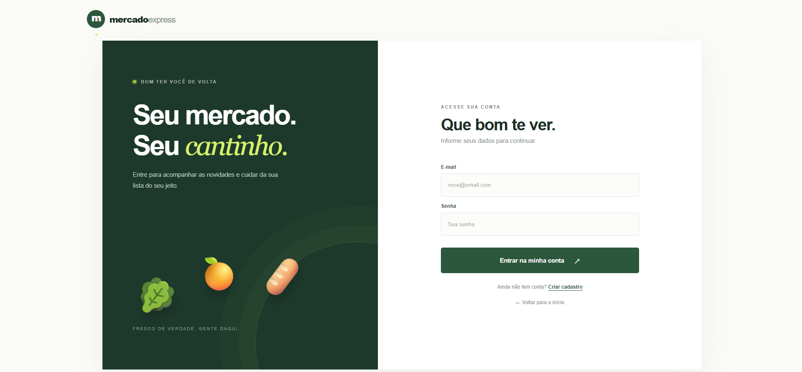

O que cada perfil pode fazer

Perfil
Depois do login
Permissões
CLIENTE
Catálogo em /catalog
Consultar produtos ativos
ADMIN
Painel em /admin/products
Consultar e administrar o catálogo

O catálogo mostra os produtos disponíveis para clientes:

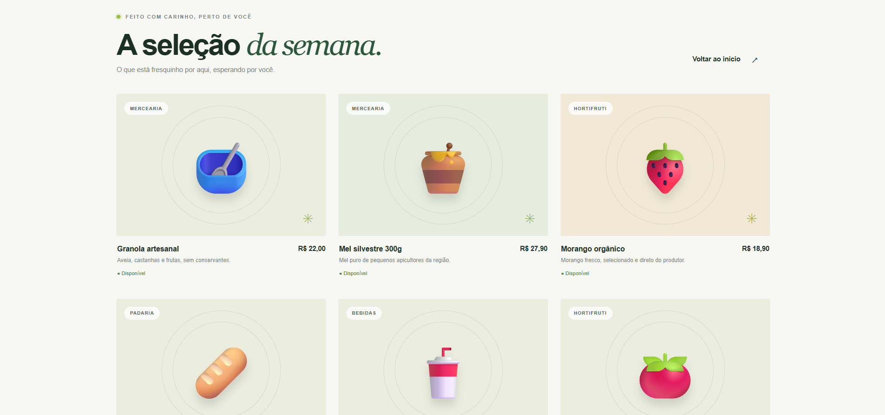

O painel do administrador apresenta o catálogo e os controles de gestão:

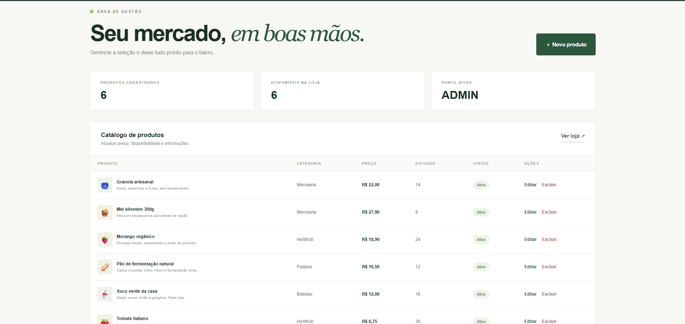

CRUD de produtos

O perfil ADMIN pode criar, consultar, atualizar e excluir produtos. Os formulários validam nome, categoria, descrição, preço e estoque. Também é possível controlar se um produto aparece no catálogo.

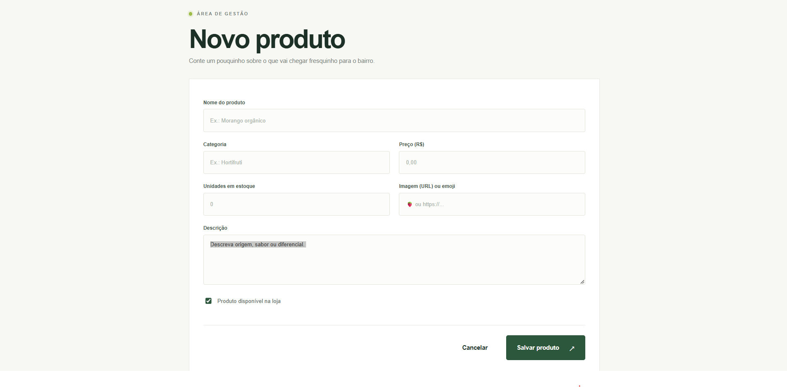

As imagens seguintes registram o fluxo de demonstração: produto cadastrado, preço atualizado e produto removido.

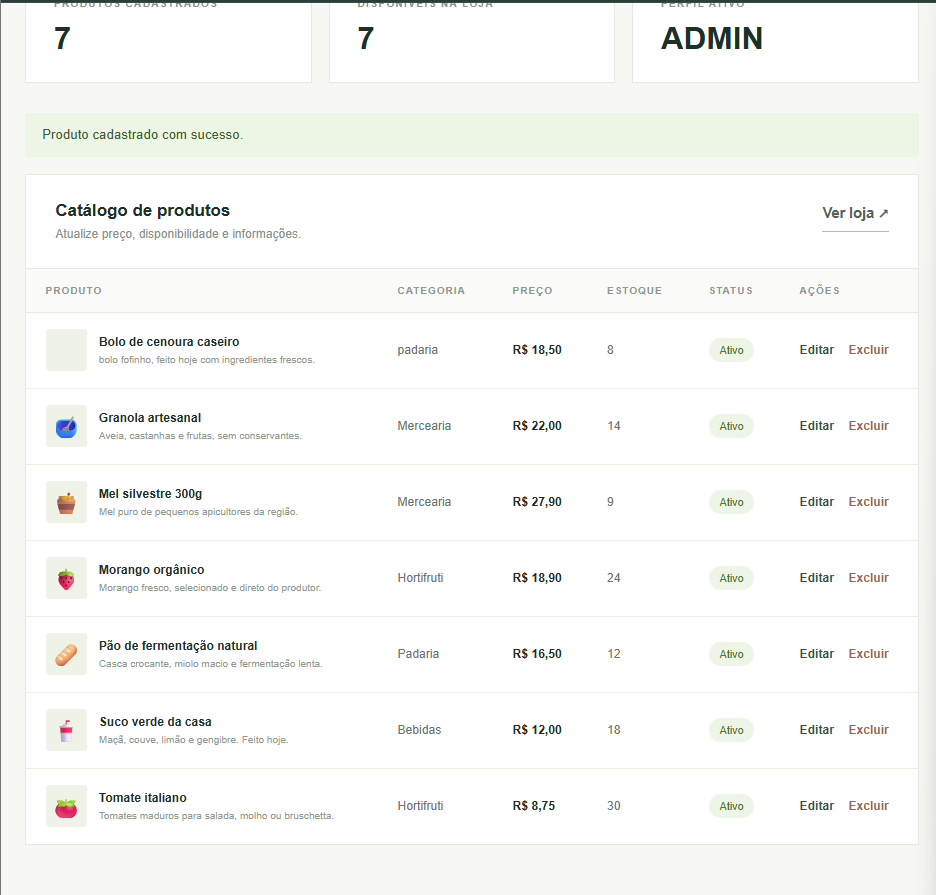

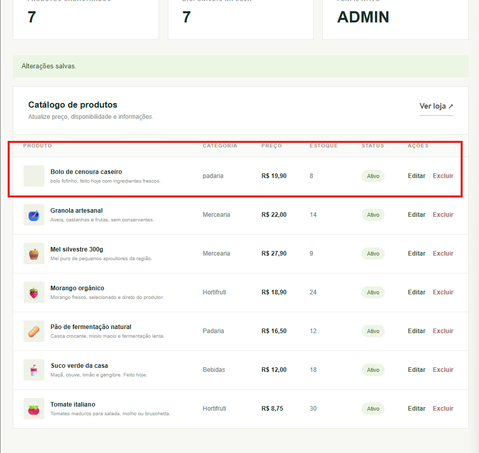

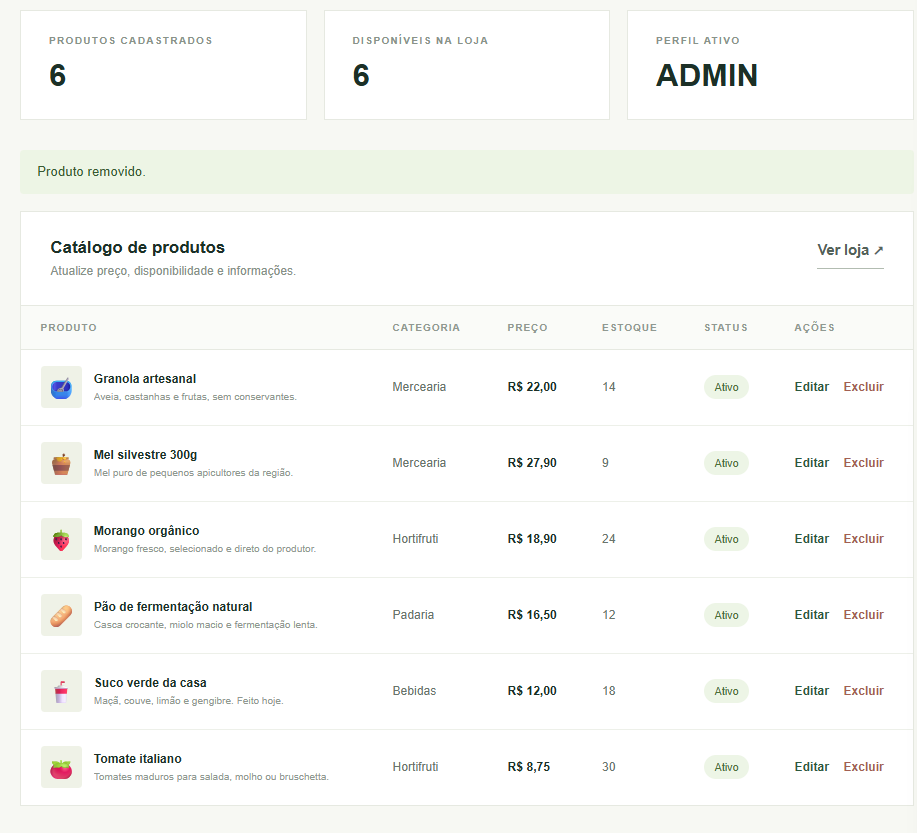

Acesso protegido

As rotas administrativas exigem o perfil ADMIN. Ao tentar abrir o painel como cliente, a aplicação retorna HTTP 403 (Forbidden), bloqueando o acesso.

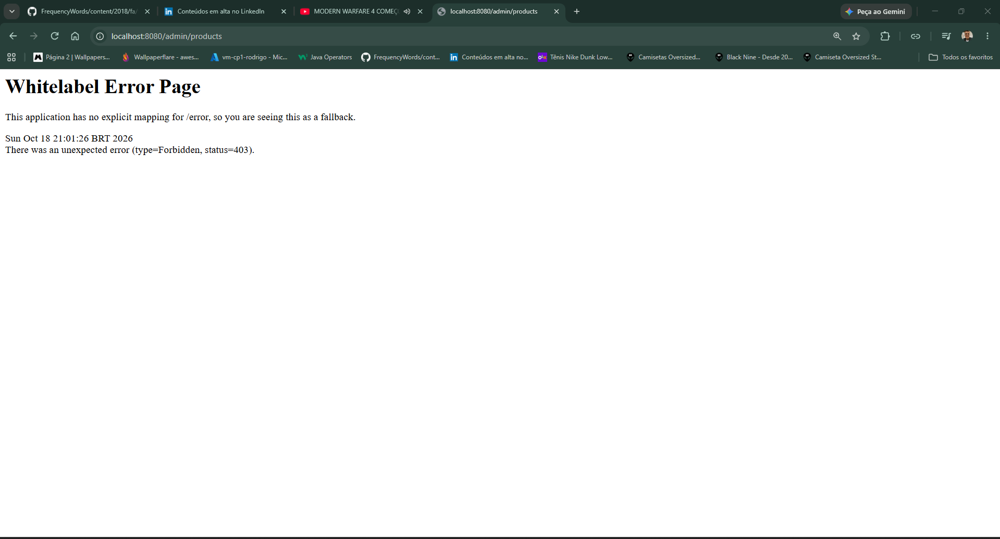

Tecnologias e configuração

Java 17 e Maven
Spring Boot 3.3.5, Spring MVC e Spring Web
Thymeleaf e Thymeleaf Extras Spring Security
Spring Security 6 com autenticação por formulário, autorização por perfil e senhas BCrypt
Spring Data JPA e PostgreSQL
Jakarta Validation e Lombok
Docker e Docker Compose como alternativa para executar o projeto

O pom.xml é a configuração efetivamente usada para compilar a aplicação. Ele contém as dependências Maven do projeto, inclusive Spring Boot 3.3.5, Thymeleaf Extras Spring Security e as dependências de teste.

Spring Initializr

O projeto usa Maven, Java, empacotamento JAR e Java 17. A imagem a seguir documenta a seleção das dependências no Spring Initializr. O site disponível durante a captura apresentava Spring Boot 4.x; por isso, a versão do Initializr na captura pode diferir da versão Spring Boot 3.3.5 usada no projeto. Para a versão entregue, consulte o pom.xml.

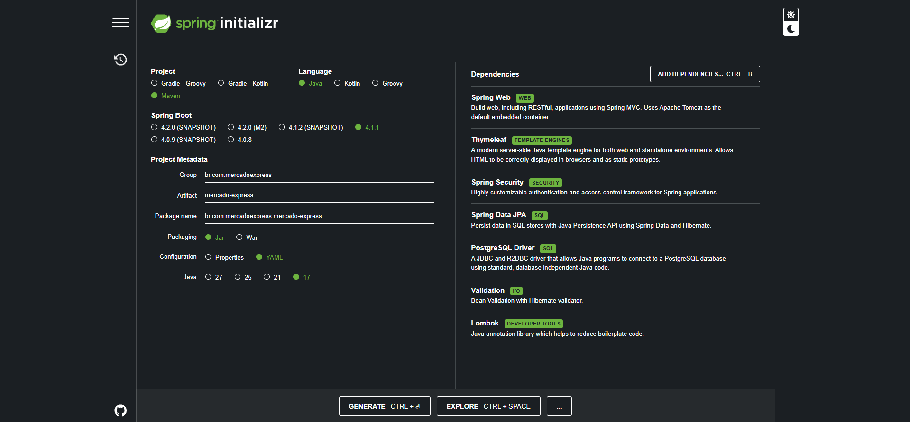

Como executar no IntelliJ IDEA

1. Requisitos

IntelliJ IDEA
JDK 17
PostgreSQL em execução
Acesso à internet para o Maven baixar as dependências na primeira abertura

Abra no IntelliJ a pasta que contém o arquivo pom.xml e aguarde a sincronização Maven.

2. Criar banco e usuário no PostgreSQL

No pgAdmin, conectado à instalação PostgreSQL que será usada pelo projeto, abra Tools → Query Tool e execute:

CREATE ROLE mercado WITH LOGIN PASSWORD 'mercado_local';
CREATE DATABASE mercado_express OWNER mercado;
GRANT ALL ON SCHEMA public TO mercado;

Se o banco mercado_express já foi criado pela interface do pgAdmin, não execute novamente a linha CREATE DATABASE. Se o usuário mercado já existe, ajuste a senha com:

ALTER ROLE mercado WITH LOGIN PASSWORD 'mercado_local';

3. Configurar variáveis no IntelliJ

Abra Run → Edit Configurations…, selecione MercadoExpressApplication, habilite Environment variables e informe:

SPRING_DATASOURCE_URL=jdbc:postgresql://localhost:5432/mercado_express;SPRING_DATASOURCE_USERNAME=mercado;SPRING_DATASOURCE_PASSWORD=mercado_local;ADMIN_NAME=Administrador do Mercado;ADMIN_EMAIL=admin@mercadoexpress.com;ADMIN_PASSWORD=defina-uma-senha-local

Use a porta em que seu PostgreSQL realmente está escutando. O exemplo usa a porta padrão 5432; se a instalação local usa outra porta (por exemplo, 5433), altere somente o número na URL. Substitua a senha de administrador por uma senha própria. Não publique senhas nem as inclua em capturas ou no GitHub.

4. Iniciar e abrir a aplicação

Execute MercadoExpressApplication pelo botão verde Run no IntelliJ. Quando o console indicar que a aplicação iniciou, abra http://localhost:8080.

Na primeira inicialização, o Hibernate cria ou atualiza as tabelas e a aplicação cadastra produtos demonstrativos, caso o catálogo esteja vazio. A conta administrativa é criada quando as variáveis ADMIN_NAME, ADMIN_EMAIL e ADMIN_PASSWORD estão configuradas.

5. Conferir os perfis e o CRUD

Na landing page, crie uma conta de cliente e entre com o e-mail e a senha usados no cadastro. O login deve levar ao catálogo.
Saia da conta de cliente. Entre com o e-mail administrativo e a senha configurada no IntelliJ; o login deve levar ao painel.
No painel, crie um produto, altere um campo e depois exclua o produto para conferir as operações de Create, Read, Update e Delete.
Entre novamente como cliente e acesse /admin/products. O resultado esperado é acesso negado (HTTP 403); o catálogo em /catalog continua permitido.

Modelo de dados

As entidades JPA mapeiam as seguintes tabelas PostgreSQL:

TDS_Sec_MVC_TB_Mercado: produto, categoria, descrição, preço, estoque, imagem/emoji, disponibilidade e data de atualização.
TDS_Users_Mercado: nome, e-mail único, hash da senha, perfil (ADMIN ou CLIENTE) e data de criação.

O arquivo src/main/resources/application.yml configura a URL, usuário e senha do banco por variáveis de ambiente, com valores locais padrão. spring.jpa.hibernate.ddl-auto=update está configurado para facilitar a execução acadêmica local; um sistema de produção deveria usar migrações versionadas e uma política de esquema apropriada.

Deploy

URL de produção: https://mercado-express-spring.onrender.com/

O deploy foi publicado no Render usando Docker e PostgreSQL. O plano gratuito pode suspender o serviço quando fica inativo; a primeira visita após um período parado pode levar alguns instantes para iniciar. Não envie credenciais ao repositório.

Capturas do projeto

As capturas deste README devem ser arquivos PNG dentro de docs/images/. Os links acima esperam estes nomes:

01-landing-page.png
02-cadastro.png
03-login.png
04-catalogo-cliente.png
05-painel-admin.png
06-formulario-produto.png
07-produto-cadastrado.png
08-produto-editado.png
09-produto-excluido.png
10-acesso-negado-cliente.png
11-spring-initializr.png

Se o nome de algum arquivo salvo for diferente, ajuste o caminho da imagem neste README para corresponder exatamente ao nome no GitHub — incluindo maiúsculas, minúsculas e a extensão .png.

Entrega

O arquivo ENTREGA.txt reúne os integrantes e os campos para completar antes de enviar o trabalho diretamente ao professor pelo chat individual do Teams. Antes do envio, preencham a turma e o curso, substituam o endereço de deploy pendente pela URL publicada e confirmem que as capturas estão no repositório.
