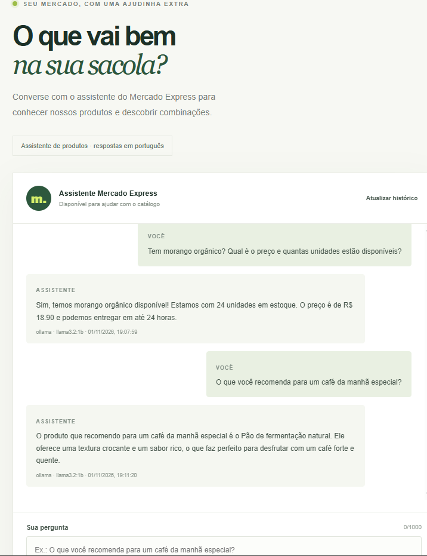
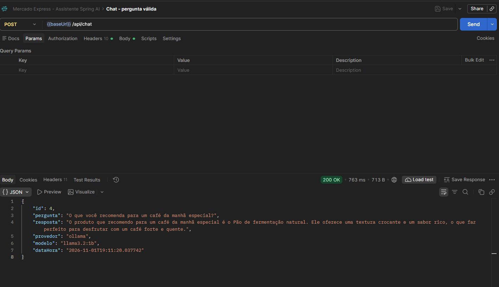
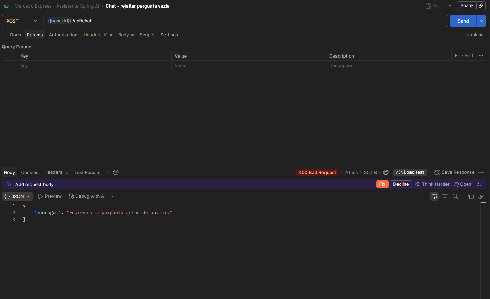
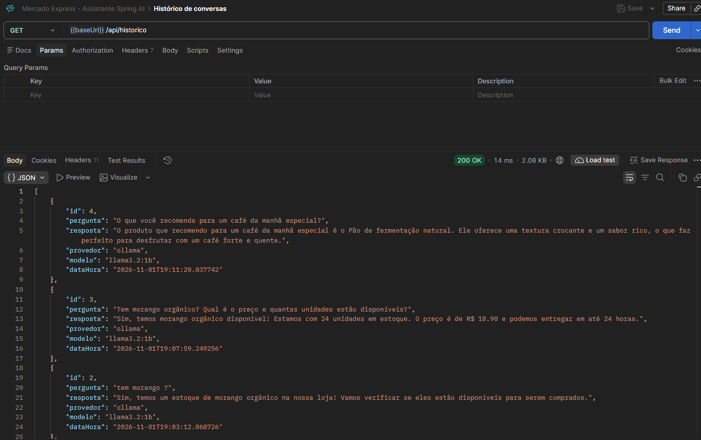

# Mercado Express

**Bom de perto. Melhor ainda na sua casa.**

Projeto acadêmico de um mercado de bairro fictício, desenvolvido em Java com Spring Boot, Spring Security, Spring Data JPA, Thymeleaf e PostgreSQL. Para o Checkpoint 6, o sistema ganhou um assistente de atendimento em português: ele consulta um modelo local pelo Spring AI, usa o catálogo de produtos como contexto e salva as conversas no banco.

## Visão geral

O cliente pode criar uma conta, consultar o catálogo e conversar com o assistente pela página `/chat`. O assistente utiliza um modelo real do Ollama: as respostas são geradas pelo modelo e não são mensagens fixas. A aplicação também disponibiliza uma API REST para conversar e consultar o histórico.

- **Assistente:** atendimento e recomendações baseadas nos produtos ativos, preços e estoque do catálogo.
- **Privacidade e custo:** Ollama executado localmente; nenhuma chave de API ou crédito de provedor externo é necessário.
- **Contas:** novos cadastros recebem o perfil `CLIENTE`; as páginas administrativas são protegidas pelo perfil `ADMIN`.
- **Histórico:** pergunta, resposta, data/hora, provedor e modelo ficam persistidos no PostgreSQL.

## Tecnologias e versões

| Tecnologia | Versão ou uso |
|---|---|
| Java | 17 |
| Spring Boot | 3.4.5 |
| Spring AI | 1.0.0 |
| Modelo de IA | Ollama `llama3.2:1b` (configurável) |
| Persistência | Spring Data JPA e PostgreSQL |
| Interface | Spring MVC, Thymeleaf, HTML, CSS e JavaScript |
| Segurança | Spring Security, perfis `CLIENTE` e `ADMIN`, senhas BCrypt |
| Build e testes | Maven, Maven Wrapper e JUnit |
| IDE utilizada | IntelliJ IDEA |

As versões efetivamente configuradas estão no `pom.xml`. A configuração do Ollama fica em `src/main/resources/application.yml`; o modelo pode ser alterado pela variável `OLLAMA_CHAT_MODEL`.

## Integrantes

| Integrante | RM |
|---|---|
| Natália Cristina | RM564099 |
| Nickolas Davi | RM564105 |
| Rodrigo Silva | RM565162 |
| Samara Vilela | RM566133 |
| Otávio Ferreira | RM565960 |

**Turma:** 2TDSR
**Instituição:** FIAP — 2026
**Curso:** Tecnologia em Análise e Desenvolvimento de Sistemas
**IDE utilizada:** IntelliJ IDEA
**GitHub:** [Rcsilva05/mercado-express-spring](https://github.com/Rcsilva05/mercado-express-spring)

## Arquitetura do assistente

1. `ChatController` valida e recebe as chamadas HTTP.
2. `ChatService` monta o prompt de sistema e acrescenta os produtos ativos do catálogo, incluindo preço e quantidade em estoque.
3. Spring AI `ChatClient` envia a pergunta ao modelo Ollama configurado.
4. `ChatHistoryRepository` armazena as conversas concluídas em PostgreSQL.
5. `/chat` apresenta as mensagens e permite consultar novamente o histórico pela API.

O prompt instrui o modelo a responder em português, não inventar dados do mercado e indicar preço e estoque com base no catálogo. Como em outros modelos generativos, a redação da resposta pode variar; os valores do catálogo continuam sendo a fonte dos dados.

## Evidências do Checkpoint 6

O assistente em execução usa os dados de preço e estoque do catálogo:



Resposta válida da API pelo Postman (**200 OK**):



A API rejeita perguntas vazias (**400 Bad Request**):



O histórico retorna as conversas registradas, da mais recente para a mais antiga:



## Como executar no Windows

### 1. Instalar os pré-requisitos

- JDK 17.
- Ollama para Windows.
- PostgreSQL local **ou** Docker Desktop, se preferir iniciar o banco em contêiner.
- IntelliJ IDEA (opcional; os comandos abaixo também podem ser usados no PowerShell).
- Conexão à internet na primeira execução, para baixar o Maven e as dependências do projeto.

Confira no PowerShell:

```powershell
java -version
ollama --version
```

### 2. Baixar e verificar o modelo local

Baixe o modelo uma vez e confirme o nome:

```powershell
ollama pull llama3.2:1b
ollama list
```

O nome de `OLLAMA_CHAT_MODEL` deve corresponder exatamente ao apresentado por `ollama list`. O Ollama normalmente inicia o serviço em segundo plano; confira a API abrindo <http://localhost:11434/api/tags>. Se o serviço estiver parado, execute `ollama serve` em um terminal, apenas se a porta `11434` estiver livre. Não inicie uma segunda instância.

### 3. Criar e iniciar o PostgreSQL

**Opção A — PostgreSQL instalado no Windows**

1. Abra o pgAdmin e conecte-se ao servidor PostgreSQL com uma conta administradora.
2. Abra o Query Tool no banco `postgres` e execute as instruções de `database/create-database.sql`. Crie primeiro o usuário e o banco; se algum deles já existir, não repita a instrução de criação correspondente.
3. Se a sua instalação já estiver usando o nome de usuário `mercado`, atualize a senha local ou escolha uma senha própria. Use no projeto a porta em que o serviço realmente está ouvindo. A porta padrão costuma ser `5432`; neste ambiente de desenvolvimento, a instalação local pode usar `5433`.

**Opção B — PostgreSQL em Docker**

1. Copie `.env.example` para `.env` e substitua `ADMIN_PASSWORD` por uma senha local antes de usar o Docker Compose. O arquivo `.env` é local e não deve ser enviado ao GitHub.
2. No PowerShell, na pasta do projeto, execute:

   ```powershell
   docker compose up -d postgres
   docker compose ps postgres
   ```

3. O PostgreSQL do Compose fica disponível para a aplicação no computador em `localhost:5433`. O mapeamento `5433:5432` evita conflito com instalações locais que já ocupam a porta `5432`. Se `5433` também estiver ocupada, altere a porta do lado esquerdo em `docker-compose.yml` e use essa porta na URL JDBC.

### 4. Configurar a conexão da aplicação

Abra a pasta que contém `pom.xml` no IntelliJ. Em **Run → Edit Configurations…**, selecione `MercadoExpressApplication` e configure as variáveis de ambiente da tabela abaixo. No Windows, separe as variáveis por ponto e vírgula no campo da IDE.

| Variável | Exemplo |
|---|---|
| `SPRING_DATASOURCE_URL` | `jdbc:postgresql://localhost:5433/mercado_express` |
| `SPRING_DATASOURCE_USERNAME` | `mercado` |
| `SPRING_DATASOURCE_PASSWORD` | A senha definida para o usuário local do banco |
| `ADMIN_NAME` | `Administrador do Mercado` |
| `ADMIN_EMAIL` | `admin@mercadoexpress.com` |
| `ADMIN_PASSWORD` | Uma senha local escolhida por você |
| `OLLAMA_BASE_URL` | `http://localhost:11434` |
| `OLLAMA_CHAT_MODEL` | `llama3.2:1b` |

**Atenção:** para PostgreSQL instalado no Windows, informe a porta que essa instalação realmente usa. Para o PostgreSQL do Docker Compose, use a porta `5433` do computador. Não publique senhas reais, não as inclua no README nem em capturas de tela e mantenha `.env` fora do Git.

Se preferir usar o PowerShell, entre na pasta do projeto, preencha os valores locais no terminal e inicie a aplicação nessa mesma janela:

```powershell
$env:SPRING_DATASOURCE_URL = "jdbc:postgresql://localhost:5433/mercado_express"
$env:SPRING_DATASOURCE_USERNAME = "mercado"
$env:SPRING_DATASOURCE_PASSWORD = "SUA_SENHA_LOCAL"
$env:ADMIN_NAME = "Administrador do Mercado"
$env:ADMIN_EMAIL = "admin@mercadoexpress.com"
$env:ADMIN_PASSWORD = "SUA_SENHA_DE_ADMIN_LOCAL"
$env:OLLAMA_BASE_URL = "http://localhost:11434"
$env:OLLAMA_CHAT_MODEL = "llama3.2:1b"
```

Troque a URL JDBC se sua instalação usar outra porta. Essas variáveis ficam somente na janela atual do PowerShell.

### 5. Executar os testes automatizados

No PowerShell, dentro da pasta do projeto:

```powershell
.\mvnw.cmd test
```

Os testes verificam a resposta JSON, a validação de perguntas vazias ou muito longas, a resposta de indisponibilidade, a consulta ao histórico e a construção do prompt com dados do catálogo. O provedor é simulado nos testes automatizados; não é necessário iniciar Ollama ou PostgreSQL para executá-los.

### 6. Iniciar e testar a aplicação

Inicie o Ollama e confirme que ele mostra o modelo instalado. Confirme também que o PostgreSQL está em execução e que a URL, o usuário e a senha da aplicação correspondem a esse banco.

Pelo IntelliJ, execute `MercadoExpressApplication`. Pelo PowerShell, use:

```powershell
.\mvnw.cmd spring-boot:run
```

Quando o console mostrar que a aplicação iniciou na porta `8080`, abra <http://localhost:8080/chat>. Pergunte, por exemplo:

> Tem morango orgânico? Qual é o preço e quantas unidades estão disponíveis?

O catálogo demonstrativo inclui morango orgânico por R$ 18,90 e 24 unidades em estoque. O texto gerado pode variar, mas os dados devem corresponder ao catálogo. Na primeira inicialização, o Hibernate cria ou atualiza as tabelas; a aplicação também cadastra produtos demonstrativos caso o catálogo esteja vazio.

## API REST

### Enviar uma pergunta

`POST /api/chat` recebe JSON com uma pergunta não vazia de até 1000 caracteres:

```http
POST http://localhost:8080/api/chat
Content-Type: application/json
```

```json
{
  "mensagem": "Tem morango orgânico? Qual é o preço e quantas unidades estão disponíveis?"
}
```

Resposta de sucesso (**HTTP 200**):

```json
{
  "id": 1,
  "pergunta": "Tem morango orgânico? Qual é o preço e quantas unidades estão disponíveis?",
  "resposta": "O morango orgânico está disponível por R$ 18,90. Há 24 unidades em estoque.",
  "provedor": "ollama",
  "modelo": "llama3.2:1b",
  "dataHora": "2026-11-01T19:07:59.249256"
}
```

O texto acima ilustra o formato da resposta. O conteúdo é gerado pelo modelo e pode mudar entre chamadas.

### Consultar o histórico

`GET /api/historico` devolve as conversas persistidas, em ordem decrescente de data/hora:

```http
GET http://localhost:8080/api/historico
```

### Validar e testar falhas

| Cenário | Resultado esperado |
|---|---|
| Pergunta válida e Ollama disponível | `200 OK`, resposta e metadados |
| Pergunta vazia ou maior que 1000 caracteres | `400 Bad Request`, mensagem de validação |
| JSON inválido | `400 Bad Request`, instrução para enviar JSON válido |
| Ollama desligado ou modelo indisponível | `503 Service Unavailable`, mensagem segura sem detalhes internos |
| Consultar histórico | `200 OK`, lista de conversas mais recentes primeiro |

## Testes com Postman

Importe `postman/Mercado-Express-Spring-AI.postman_collection.json` no Postman (**Import → Files**). A coleção contém:

1. **Chat - pergunta válida:** envia uma pergunta ao modelo real; esperado `200 OK`.
2. **Chat - rejeitar pergunta vazia:** valida a mensagem obrigatória; esperado `400 Bad Request`.
3. **Chat - simular provedor indisponível:** envie uma pergunta válida após parar temporariamente o Ollama; esperado `503 Service Unavailable`. Reinicie o Ollama após o teste.
4. **Histórico de conversas:** lista as interações registradas; esperado `200 OK`.

A variável `baseUrl` da coleção já está definida como `http://localhost:8080`.

## Verificar as conversas no PostgreSQL

No pgAdmin, conecte-se ao banco `mercado_express` e consulte a tabela `chat_history`. Também é possível executar:

```sql
SELECT id, question, answer, created_at, provider, model
FROM chat_history
ORDER BY created_at DESC;
```

As tabelas de produtos e usuários são `TDS_Sec_MVC_TB_Mercado` e `TDS_Users_Mercado`. As senhas de usuários são armazenadas com hash BCrypt.

## Rotas principais

| Rota | Acesso | Descrição |
|---|---|---|
| `/` | Público | Página inicial e produtos selecionados |
| `/signup` e `/login` | Público | Cadastro de cliente e autenticação |
| `/chat` | Público | Interface web do assistente |
| `POST /api/chat` | Público | Enviar pergunta ao assistente |
| `GET /api/historico` | Público | Consultar conversas salvas |
| `/catalog` | `CLIENTE` ou `ADMIN` | Catálogo de produtos ativos |
| `/admin/products` | `ADMIN` | Painel de gerenciamento do catálogo |

## Estrutura útil do repositório

```text
src/main/java/br/com/mercadoexpress/
  controller/    Páginas MVC e API REST do assistente
  model/         Entidades JPA, inclusive o histórico do chat
  repository/    Repositórios Spring Data JPA
  security/      Configuração de autenticação e autorização
  service/       Regras de negócio e integração Spring AI
  web/           Formulários e DTOs da aplicação
src/main/resources/
  templates/     Páginas Thymeleaf
  static/css/    Estilos
  static/js/     JavaScript da interface do assistente
docs/images/     Capturas do Checkpoint 6 e evidências dos testes
database/        Script de configuração local do PostgreSQL
postman/         Coleção de testes da API
```

## Solução de problemas

- **`JAVA_HOME` não configurado ou `java` não encontrado:** instale o JDK 17 e reinicie o IntelliJ ou o PowerShell para carregar a configuração atualizada.
- **Ollama indisponível:** abra o aplicativo Ollama e confira <http://localhost:11434/api/tags>. Não execute `ollama serve` se o serviço já estiver usando a porta.
- **Modelo não encontrado:** execute `ollama list`; instale `llama3.2:1b` com `ollama pull llama3.2:1b` ou ajuste `OLLAMA_CHAT_MODEL` para o nome exato de um modelo instalado.
- **Falha de conexão com PostgreSQL:** confira se o serviço está ativo, se o banco `mercado_express` e o usuário existem e se porta, usuário e senha nas variáveis `SPRING_DATASOURCE_*` correspondem à mesma instalação.
- **Porta `5433` ocupada:** use outra porta disponível no mapeamento de `docker-compose.yml` e atualize `SPRING_DATASOURCE_URL`; para PostgreSQL instalado, informe a porta configurada para esse serviço.
- **HTTP 503 no chat:** o endpoint está acessível, mas não recebeu uma resposta válida do Ollama. Inicie o Ollama e confira se o modelo da aplicação está instalado.
- **Maven Wrapper na primeira execução:** aguarde o download do Maven e das dependências; a primeira compilação demora mais.

## Configurações locais e segurança

As senhas de banco, credenciais locais do administrador e quaisquer outros segredos são configurados fora do código, por variáveis de ambiente. `.env.example` serve como referência; `.env` contém somente configurações da máquina local e não deve ser publicado. O Ollama local não requer chave de API.

`spring.jpa.hibernate.ddl-auto=update` está configurado para simplificar a execução acadêmica local. Para sistemas de produção, prefira migrações versionadas e uma política explícita de gerenciamento de esquema.
